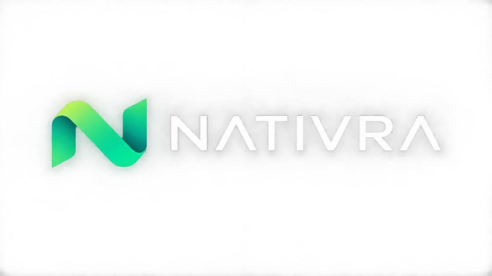

<p align="center">
  <a href="https://nativra.dev">
    
  </a>
</p>

<p align="center">
  <strong>Native UI, built your way.</strong><br />
  A source-first UI development platform for React Native & Expo.<br />
  Copy production-ready components into your codebase, own every line, and customize without runtime package locks.
</p>

<p align="center">
  <a href="https://github.com/nativra/nativra/actions"></a>
  <a href="https://npmjs.com/package/@nativra/cli"></a>
  <a href="https://reactnative.dev"></a>
  <a href="https://expo.dev"></a>
  <a href="#license"></a>
</p>

---

## What is Nativra?

Nativra combines the discoverability, accessibility, and copy-into-your-project philosophy of [shadcn/ui](https://ui.shadcn.com) with tooling and behavioral ergonomics designed specifically for native mobile apps.

Developers use Nativra to:

- 🔍 **Discover** — 70+ high-fidelity primitives, hooks, utilities, themes, blocks, and full-screen templates.
- 📱 **Preview & Inspect** — Interactive real-time mobile canvas inside the documentation site.
- 🎨 **Customize & Theme** — Tailor design tokens, radii, and semantic colors for NativeWind v4 and React Native StyleSheet.
- ⚡ **Install** — Add TypeScript sources directly to your project with `npx nativra add <item>`.
- 🛡️ **Own Your Code** — No runtime dependency lock-in; edit and maintain code directly.
- 📱 **Verify Behavior** — Test on actual iOS/Android devices using Expo and React Native New Architecture.

---

## Monorepo Architecture

```
nativra/
├── assets/                # Official brand logos, marks, and favicons
├── apps/
│   ├── docs/              # Public documentation, interactive catalog & live preview (Next.js)
│   └── native-preview/    # Expo app for native Android & iOS verification
├── packages/
│   ├── cli/               # @nativra/cli — Install, diff, update, and rollback components
│   ├── registry-schema/   # Zod validation schemas and TypeScript contracts
│   ├── registry-client/   # Upstream registry client with HTTP caching and checksums
│   ├── registry-builder/  # Compiles authored sources into registry distributions
│   ├── theme-engine/      # Semantic token model and CSS/StyleSheet adapters
│   ├── preview-runtime/   # Shared canvas runtime and test fixtures
│   ├── component-contracts/ # Core component interfaces and accessibility contracts
│   ├── config/            # Shared ESLint, Prettier, TypeScript, and Vitest configs
│   └── utils/             # Lightweight utilities (cn, style mergers)
├── registry/
│   └── default/           # Authored components, blocks, templates, and themes
├── examples/
│   ├── expo-nativewind/   # Expo example with NativeWind v4
│   └── expo-stylesheet/   # Expo example with pure StyleSheet
└── tests/
```

---

## Quick Start

### Initialize in your project

```bash
npx nativra init
```

### Add components

```bash
# Add primitives
npx nativra add button input card

# Add composite blocks
npx nativra add app-header order-summary stat-progress-card

# Add complete screen templates
npx nativra add analytics-dashboard fintech-wallet
```

---

## Development & Contributing

### Prerequisites

- Node.js >= 20.x
- pnpm >= 9.x

### Setup

```bash
# Clone the repository
git clone https://github.com/nativra/nativra.git
cd nativra

# Install workspace dependencies
pnpm install

# Build all packages & registry
pnpm build

# Run documentation locally
pnpm dev

# Run native preview in the browser
pnpm --filter @nativra/native-preview web
```

---

## Product Principles

- **Source Ownership** — Installed components live directly in your codebase; you own every line.
- **Native-First** — Built from the ground up for React Native 0.76+ (Bridgeless & TurboModule ready).
- **Dual Styling Parity** — Full 1:1 parity between NativeWind v4 and pure React Native StyleSheet.
- **Safe Operations** — Conflict detection, SHA-256 verification, and atomic rollbacks protect your codebase.
- **Zero Account Walls** — Browse, inspect, and install public components freely without logging in.

---

## License

Distributed under the [MIT License](LICENSE).
